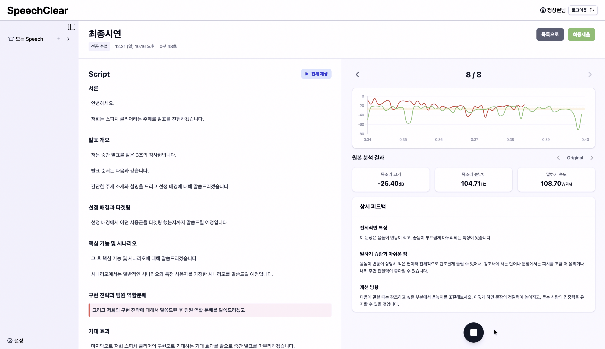

# 🎙️ SpeechClear

> AI 기반 발표 음성 분석 서비스 — 녹음된 발표를 분석하여 음성 크기·억양·속도에 대한 피드백을 제공합니다.

---

## 주요 기능

### 1. 녹음 (RecordingPage)
- 현재 날짜·시간 및 경과 타이머 표시
- 녹음 시작 / 중지 / 재시작
- 녹음 종료 시 **제목 입력 + 저장 위치(폴더) 선택** 모달
- 서버 업로드 진행률 실시간 표시 (SSE, Server-Sent Events 활용)

### 2. Speech 목록 (HomePage)
- 폴더 기반 발표 목록 구조 (모든 Speech / 커스텀 폴더)
- 발표별 최근 수정일 · 재생 시간 표시
- 사이드바에서 폴더 생성 및 이동

### 3. 발표 상세 분석 (SpeechDetailPage)
- 스크립트 뷰어 — 문장 단위 하이라이트 및 클릭 시 **해당 문장만 개별 재생** 또는 **전체 연속 재생** 지원
- 이전/다음 버튼을 통해 문장 단위(1/N)로 이동하며 개별 분석 확인
- **Chart.js를 활용한 dB(음성 크기) 시각화**
  - 서버에서 받아온 원본 음성의 dB 데이터를 선 그래프로 표현
  - **문장 재녹음 시**, 원본 그래프와 실시간으로 그려지는 재녹음 그래프를 동시에 겹쳐 보여주어 발성의 변화를 쉽게 비교 가능
- 구간별 핵심 지표 카드: **복소리 크기(dB)**, **복소리 높낮이(Hz)**, **말하기 속도(WPM)**
- 상세 피드백: 전체적인 특징 / 말하기 습관과 아쉬운 점 / 개선 방향


---

## 음성 분석 방식 (BE 제공, FE 시각화)

> FE는 BE로부터 분석 결과값을 받아 차트·카드·피드백 텍스트로 시각화합니다.  
> 분석의 핵심은 **절대값이 아닌 문장 내 상대 변화(CV, ratio)** 기반입니다.

| 지표 | 분석 방법 요약 |
|------|--------------|
| **dB** (음성 크기) | 프레임별 RMS → dB 변환, STT 타임스탬프로 실제 발화 구간만 필터링. 문장 내 평균·변동성(CV)으로 안정성 평가 |
| **Hz** (음높이, Pitch) | PYIN 알고리즘으로 기본 주파수(F0) 추출 → semitone(로그 스케일) 변환. 변동성(CV)으로 억양 자연스러움 평가 |
| **WPM** (말하기 속도) | STT 단어 수 ÷ 발화 시간. 문장 단위로 빠름/적절/느림 판단 |
| **공통** | 절대값 대신 문장 중간(baseline) vs 끝(final) 비교로 말끝 패턴(볼륨 감소, pitch 하강 등) 평가 |

---

## 🔗 Page URL

```text
/
┣ (layout) App
┃ ┣ / → HomePage (전체 발표 목록)
┃ ┣ /:folderId → HomePage (폴더별 발표 목록)
┃ ┣ /:folderId/:speechId → SpeechDetailPage (분석 상세 화면)
┃ ┣ /setting → SettingPage (사용자 설정)
┃ ┣ /recording → RecordingPage (음성 녹음 화면)
┃ ┣ /login → LoginPage (로그인)
┃ ┣ /sign-up → SignUpPage (회원가입)
┃ ┣ /:folderId/:speechId/feedback → FeedbackPage (AI 피드백 결과)
┃ ┗ /:folderId/:speechId/result → ResultPage (종합 분석 리포트)
```

## Libraries

**Core features Library**

- `react-router-dom`: 리액트 라우터 (페이지 이동 및 경로 관리)
- `zustand`: 전역 상태 관리 (인증 정보, 폴더 상태 등)
- `@tanstack/react-query`: 서버 데이터 페칭 및 캐싱 관리
- `axios`: API 통신 관리
- `dayjs`: 날짜 및 시간 포맷팅

**UI & Style**

- `tailwindcss` / `@tailwindcss/vite`: Utility-first CSS 프레임워크 및 Vite 통합
- `chart.js` / `react-chartjs-2`: 데이터 시각화 (원본/재녹음 dB 그래프 구현)
- `react-icons`: 서비스 내 주요 아이콘 라이브러리

## 📂 Project Structure

```text
src/
┣ assets/ # 이미지, 아이콘, 폰트 등 정적 리소스
┣ components/ # 재사용 가능한 공통 UI 컴포넌트
┣ service/ # axios 기반 API 통신 모듈
┃ ┣ authApi.js
┃ ┣ folderApi.js
┃ ┗ speechApi.js
┣ store/ # zustand 기반 전역 상태 관리
┃ ┣ auth/
┃ ┗ folder/
┣ pages/
┃ ┣ auth/ # 로그인 및 회원가입 관련 페이지
┃ ┃ ┣ LoginPage.jsx
┃ ┃ ┗ SignUpPage.jsx
┃ ┣ home/ # 홈 대시보드 및 설정 관련 페이지
┃ ┃ ┣ HomePage.jsx
┃ ┃ ┗ SettingPage.jsx
┃ ┗ speech/ # 녹음 및 분석 상세 관련 페이지
┃   ┣ RecordingPage.jsx
┃   ┣ SpeechDetailPage.jsx
┃   ┣ FeedbackPage.jsx
┃   ┗ ResultPage.jsx
┣ router.jsx # React Router 라우팅 설정
┣ App.jsx # 메인 레이아웃 및 라우터 Outlet 구성
┣ main.jsx # 엔트리 포인트 (Provider 설정)
┗ index.css # 전역 스타일 및 Tailwind CSS 설정
```
